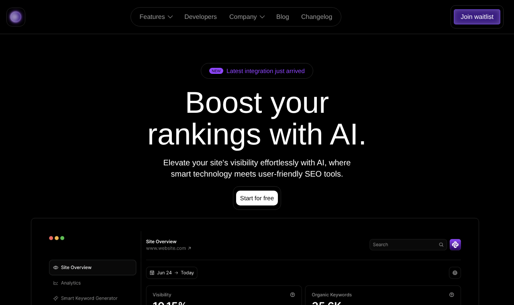

# AI SEO Tool: Landing Page

A responsive marketing landing page for a fictional AI-powered SEO product. Built from scratch with **HTML, CSS and a little JavaScript**, with no frameworks.

**▶ Live site: https://jypeejypee.github.io/landing-page-v1/**

## Sections

- Sticky navigation bar with a mobile menu toggle
- Hero with headline, call to action and a product dashboard preview
- "Trusted by" logo grid
- Feature cards (SEO goals, dashboard, visual reports, keyword generator)
- Feature summary in three columns
- Client testimonial
- Pricing plans with a monthly/yearly toggle
- Email sign-up and a multi-column footer

## Responsive

The layout adapts to desktop, tablet and phone. Feature cards, pricing plans and the summary columns stack into one column on small screens, and the menu collapses into a toggle button.

## Run it locally

No build step. Download or clone the repo and open `index.html` in your browser.

## Built with

HTML5 · CSS3 (Flexbox, Grid, media queries) · vanilla JavaScript · Google Fonts (Roboto) · Tabler icons
